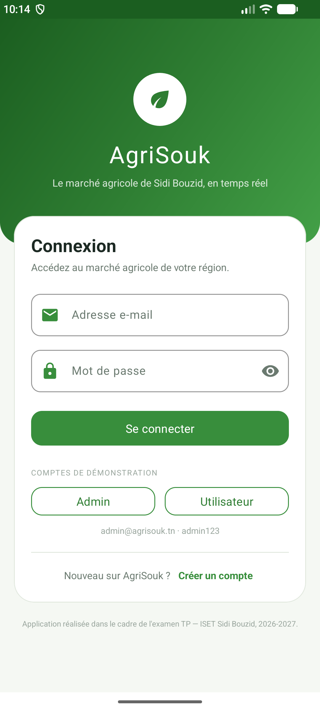
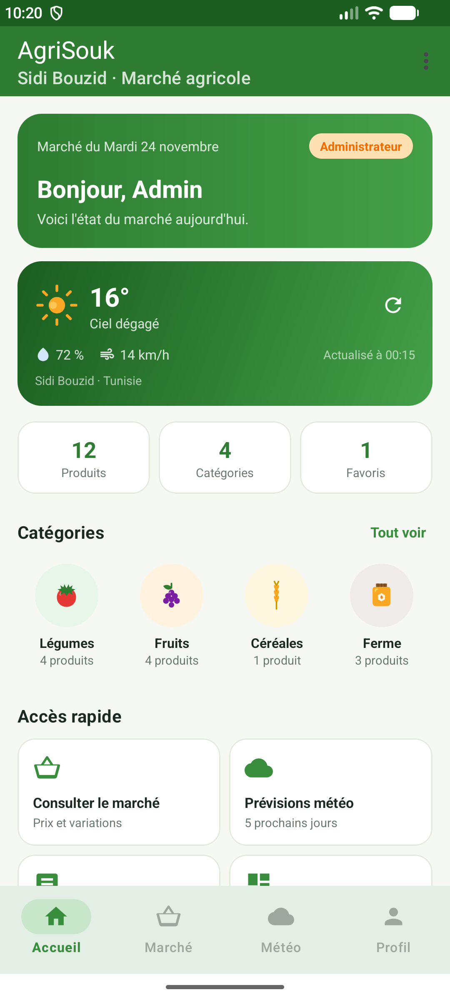
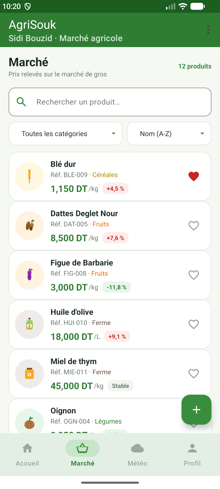
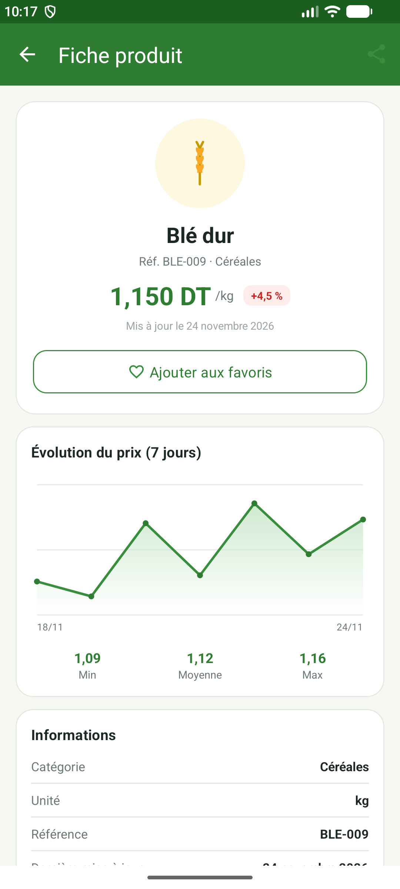
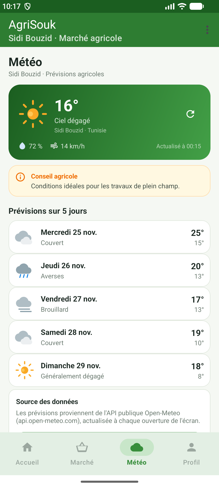
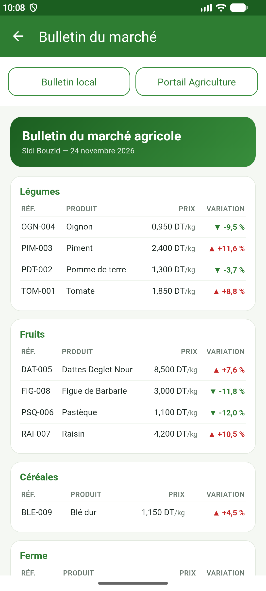
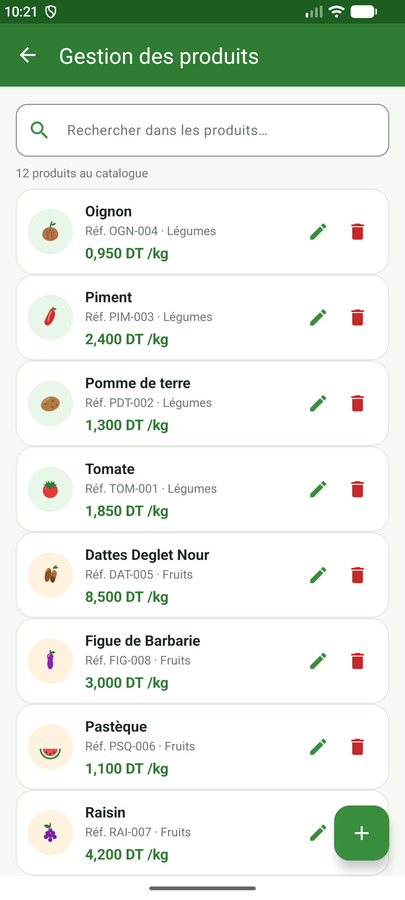
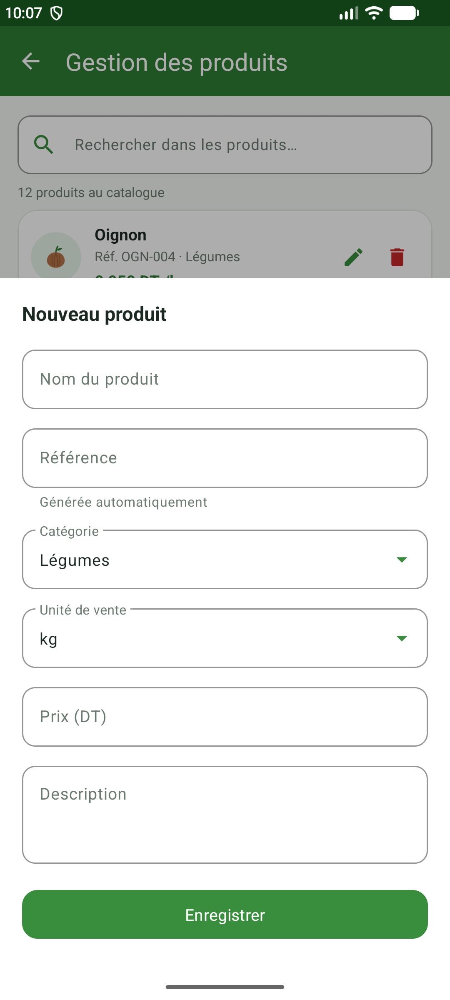
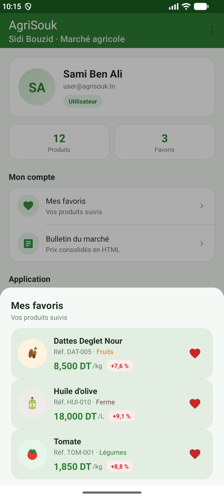

# AgriSouk — Marché agricole de Sidi Bouzid

Application Android native (Java + XML) qui met en relation les agriculteurs et les
acheteurs de la région de Sidi Bouzid : consultation des prix du marché, suivi de
l'évolution des cours, météo agricole issue d'une API publique, favoris, gestion du
catalogue et bulletin du marché consultable dans une WebView.

Réalisée dans le cadre de l'examen TP — **ISET Sidi Bouzid**, 2026-2027.

---

## Aperçu

| Connexion | Accueil administrateur | Marché |
|---|---|---|
|  |  |  |

| Fiche produit | Météo (Open-Meteo) | Bulletin local (WebView) |
|---|---|---|
|  |  |  |

| Gestion des produits | Formulaire | Mes favoris |
|---|---|---|
|  |  |  |

---

## Fonctionnalités

### Comptes et rôles
- **Inscription** d'un nouvel utilisateur (rôle `USER` automatique) avec validation des champs.
- **Connexion** sécurisée : mots de passe hachés en **SHA-256**, session conservée dans `SharedPreferences`.
- **Deux rôles** : `ADMIN` et `USER`.
  - L'administrateur voit la gestion du catalogue (bouton flottant, lignes modifier/supprimer).
  - L'utilisateur ne voit que la consultation et ses favoris.
  - L'écran de gestion est protégé : il n'est ni exporté, ni accessible sans le rôle admin.
- Comptes de démonstration prêts à l'emploi (boutons sur l'écran de connexion).

### Marché
- Liste des produits avec prix, unité, catégorie et variation du jour.
- **Recherche instantanée** par nom ou référence.
- **Filtre par catégorie** et **tri** (nom, prix croissant/décroissant, plus récents).
- **Favoris** par utilisateur (cœur sur chaque ligne, écran « Mes favoris »).
- Compteur de résultats et état vide avec bouton de réinitialisation.

### Fiche produit
- Prix, tendance, unité, référence, description.
- **Graphique 7 jours** dessiné à la main (`View` personnalisée + `Canvas`) avec minimum, moyenne et maximum.
- Bouton favori et **partage** du prix via le partage Android.

### Météo agricole (API externe)
- Conditions actuelles + **prévisions sur 5 jours** via **Open-Meteo** (HTTPS, JSON, sans clé).
- Code météo traduit en libellé et icône, **conseil agricole** contextuel.
- Mise en cache locale (`SharedPreferences`) : l'écran reste lisible hors connexion.
- Rechargement par glissement (`SwipeRefreshLayout`) et bouton d'actualisation.

### Administration (CRUD)
- Liste de tous les produits avec recherche.
- **Ajout**, **modification**, **suppression** avec confirmation.
- Référence générée automatiquement à partir de la catégorie (ex. `TOM-001`).
- Formulaire en `BottomSheet` (Material 3) avec listes déroulantes catégorie/unité.

### Bulletin du marché (WebView)
- **Bulletin local** : page HTML générée à partir de la base SQLite (regroupée par catégorie).
- **Portail distant** : chargement du site `https://www.agriculture.tn/`.
- Barre de progression, gestion d'erreur et bouton « Réessayer ».

---

## Les vues complexes du cours

| Vue du cours | Utilisation dans AgriSouk |
|---|---|
| **ListView + `BaseAdapter` + `ViewHolder`** | `ProductAdapter`, `AdminProductAdapter`, `WeatherAdapter`. Recyclage via `convertView` et le patron `ViewHolder`. |
| **GridView** | Grille des catégories du tableau de bord (`gridCategories`, `CategoryAdapter`). |
| **WebView** | Bulletin local (`loadDataWithBaseURL`) et portail Agriculture (`loadUrl`), avec `WebViewClient`, `WebChromeClient`, JavaScript et gestion du bouton retour. |

S'y ajoute une **vue personnalisée** (`PriceChartView`) qui dessine le graphique de prix
sur un `Canvas`.

---

## API externe

- **Open-Meteo** — `https://api.open-meteo.com/v1/forecast`
  - Aucune clé requise, réponses JSON lues avec `org.json`.
  - Appel réseau sur un `ExecutorService`, résultat renvoyé au thread principal via `Handler`.
  - Prévisions quotidiennes (min/max, code météo, humidité, vent).
- **agriculture.tn** — portail officiel chargé dans la WebView (permission `INTERNET`).

---

## Architecture du projet

```
app/src/main/java/tn/isetsb/agrisouk/
├── api/          WeatherApi.java           Appel Open-Meteo + cache
├── data/         DatabaseHelper, ProductRepository, UserRepository
├── model/        Product, User, Weather, WeatherDay, PricePoint
├── ui/           Splash, Login, Register, Main, ProductDetail, Admin, WebView, ProductFormSheet
│   ├── adapter/  ProductAdapter, AdminProductAdapter, CategoryAdapter, WeatherAdapter
│   ├── fragment/ Home, Market, Weather, Profile, FavoritesDialog
│   └── widget/   PriceChartView (vue personnalisée)
└── util/         SecurityUtils (SHA-256), SessionManager, FormatUtils, WeatherCodes, ProductImages
```

- **Navigation** : `MainActivity` + `BottomNavigationView`, fragments conservés en
  `show`/`hide` (l'état est préservé d'un onglet à l'autre). Retour géré par
  `OnBackPressedDispatcher`.
- **Interface** : Material 3 (thème vert agricole), `TextInputLayout`, `MaterialCardView`,
  `SwipeRefreshLayout`, `FloatingActionButton`, `BottomSheetDialogFragment`, icônes
  vectorielles et icône adaptative.

### Base de données (SQLite)

| Table | Contenu |
|---|---|
| `users` | comptes (nom, e-mail, téléphone, mot de passe haché, rôle) |
| `products` | catalogue (référence, nom, catégorie, prix, prix précédent, unité, description) |
| `price_history` | historique des prix (source du graphique 7 jours) |
| `favorites` | association utilisateur ↔ produit |

Un jeu de données de démonstration (12 produits, 4 catégories) est inséré au premier lancement.

---

## Comptes de démonstration

| Rôle | E-mail | Mot de passe |
|---|---|---|
| Administrateur | `admin@agrisouk.tn` | `admin123` |
| Utilisateur | `user@agrisouk.tn` | `user123` |

Les boutons **Admin** et **Utilisateur** de l'écran de connexion remplissent
automatiquement ces identifiants.

---

## Lancer le projet

### Prérequis
- Android Studio (AGP 9.4.1, Gradle 9.6, JDK 17+).
- Appareil ou émulateur **Android 7.0 (API 24)** minimum.

### Étapes
1. Ouvrir le dossier `AgriSouk` dans Android Studio.
2. Laisser Gradle synchroniser.
3. Lancer la configuration **app** sur un émulateur ou un téléphone.

### En ligne de commande
```bash
# Windows
gradlew.bat :app:assembleDebug

# Linux / macOS
./gradlew :app:assembleDebug
```
L'APK de test est généré dans `app/build/outputs/apk/debug/app-debug.apk`.

> L'APK prêt à installer est également fourni dans `livrables/` à la racine du dossier
> de rendu.

---

## Correspondance avec le cahier d'examen

| Critère | Réalisation |
|---|---|
| **Sujet réel et fonctionnel (12 pts)** | Application complète de marché agricole : comptes, rôles, marché, filtres, favoris, fiche produit, météo, CRUD admin, bulletin. |
| **Historique GitHub (2 pts)** | Dépôt Git structuré en commits logiques (voir plus bas). |
| **API externe (2 pts)** | Open-Meteo (météo) + portail `agriculture.tn` dans la WebView. |
| **APK installable (1 pt)** | `livrables/AgriSouk-debug.apk`, installé et testé sur émulateur. |
| **Originalité (3 pts)** | Thème agricole local, graphique de prix maison, conseils agricoles selon la météo, bulletin HTML généré depuis SQLite. |
| **Vues complexes** | `ListView`/`BaseAdapter`/`ViewHolder`, `GridView`, `WebView`. |

---

## Historique Git

Le dépôt suit une progression logique, proche d'un vrai développement :

1. Initialisation du projet Android et du thème.
2. Couche de données (modèles, SQLite, dépôts, session, sécurité).
3. Écrans d'authentification (splash, connexion, inscription).
4. Coquille principale (navigation, fragments, menu).
5. Tableau de bord (accueil, grille de catégories).
6. Marché (liste, recherche, filtres, tri, favoris).
7. Fiche produit et graphique de prix.
8. Météo via l'API Open-Meteo.
9. Administration (CRUD complet) et formulaire.
10. Bulletin WebView (local + distant).
11. Captures, documentation et livrables.

---

## Déclaration de l'assistance IA

Conformément aux règles de l'examen TP, l'utilisation d'assistants IA comme **support**
(correction, structuration, documentation) est déclarée. Le code a été relu, compris et
validé fonctionnalité par fonctionnalité sur appareil émulé ; les choix d'architecture,
de base de données et d'interface sont assumés et défendus par l'auteure du projet.

---

## Crédits

- Données météo : [Open-Meteo](https://open-meteo.com/) (licence CC BY 4.0).
- Portail institutionnel : [agriculture.tn](https://www.agriculture.tn/).
- Icônes : drawables vectoriels créés pour le projet.
- Projet réalisé par l'étudiante — ISET Sidi Bouzid, 2026-2027.
